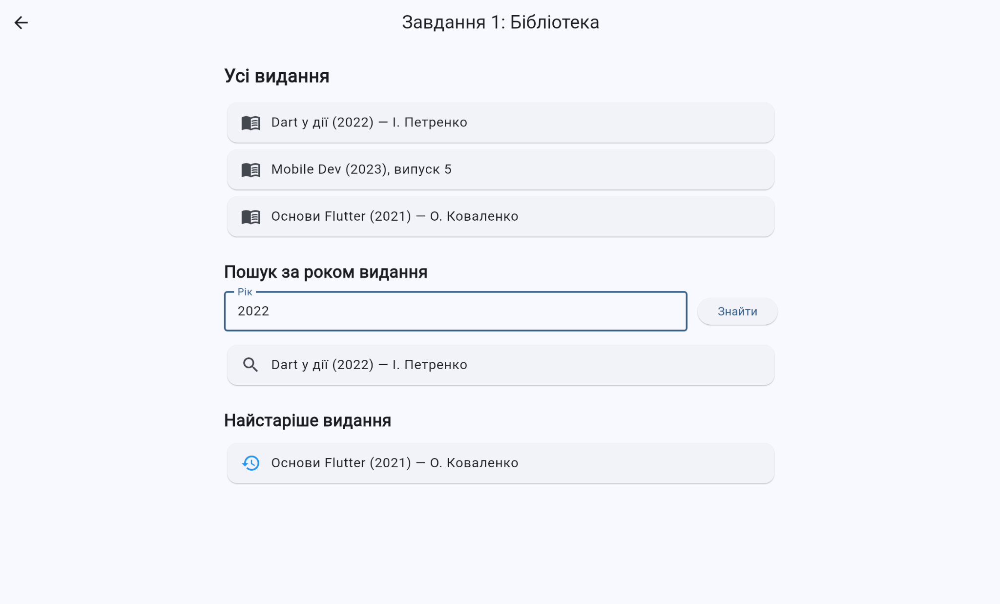
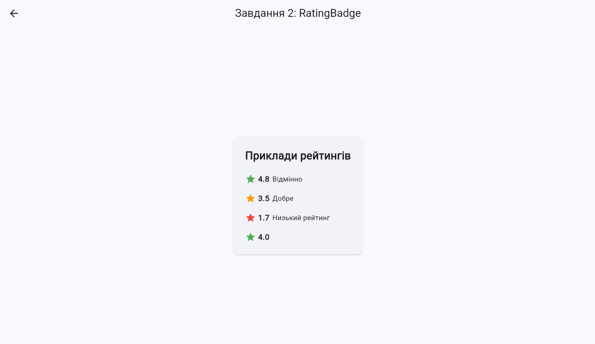
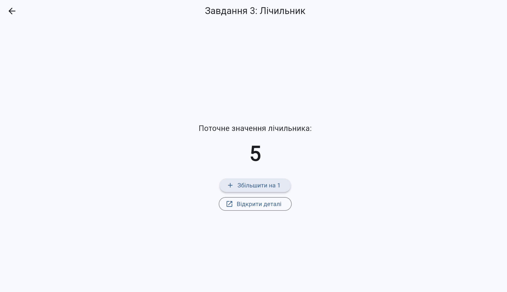
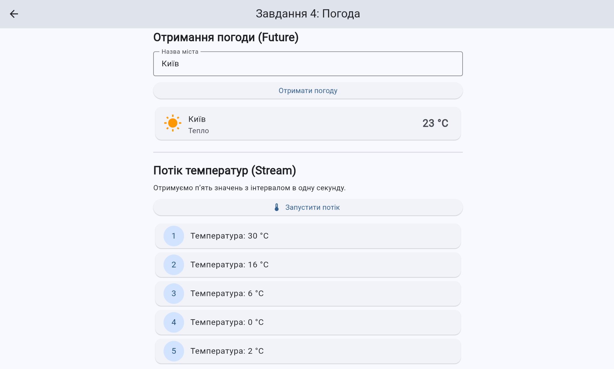

# Модульний контроль 1: Вступ до мобільної розробки

### Завдання 1. Класи та колекції

Реалізовано систему класів для представлення елементів бібліотеки.

- `LibraryItem` — абстрактний базовий клас із назвою, роком видання та методом `describe()`.
- `Book` — клас книги з інформацією про автора.
- `Magazine` — клас журналу з номером випуску.
- `Library` — клас для зберігання та обробки елементів бібліотеки.

Реалізовано такі операції:

- додавання елементів до бібліотеки;
- пошук видань за роком за допомогою `where()`;
- отримання описів усіх видань за допомогою `map()`;
- пошук найстарішого видання;
- повернення `null`, якщо бібліотека порожня.

Для демонстрації створено екран зі списком видань, пошуком за роком і відображенням найстарішого видання.

### Завдання 2. Багаторазово використовуваний віджет RatingBadge

Створено віджет `RatingBadge` на основі `StatelessWidget`.

Віджет приймає обов'язковий параметр `rating` і необов'язковий параметр `label`. Рейтинг відображається разом із зіркою та округлюється до одного знака після коми.

Колір зірки залежить від значення рейтингу:

- зелений — рейтинг від 4.0;
- помаранчевий — рейтинг від 2.5 до значень, менших за 4.0;
- червоний — рейтинг менший за 2.5.

Визначення кольору винесено в окремий геттер `ratingColor`. Конструктор віджета підтримує використання `const`.

### Завдання 3. Керування станом і навігація

Реалізовано екран лічильника `CounterScreen`, початкове значення якого дорівнює нулю.

Для збільшення значення використовується `setState()`. За допомогою `Navigator.push()` відкривається екран деталей `DetailScreen`, якому передається поточне значення лічильника через параметр конструктора `counterValue`.

Кнопка повернення використовує `Navigator.pop()` для переходу на попередній екран.

### Завдання 4. Асинхронна обробка даних

Створено клас `WeatherService`, який демонструє роботу з асинхронними операціями.

Метод `fetchCurrentWeather(String city)`:

- перевіряє, чи вказано назву міста;
- генерує помилку `ArgumentError`, якщо назва порожня;
- імітує затримку отримання даних;
- повертає інформацію про місто, температуру та опис погоди у вигляді `Map<String, dynamic>`.

Метод `temperatureUpdates({int times = 5})` реалізовано за допомогою `async*`. Він генерує потік випадкових температур із затримкою в одну секунду між значеннями.

Для демонстрації використано `async/await`, обробку помилок через `try/catch` і отримання даних із потоку за допомогою `await for`.

**Примітка:** дані про погоду генеруються локально для демонстрації асинхронності. Підключення до реального погодного API не реалізовано.

## Структура проєкту

```text
module1/
├── lib/
│   ├── main.dart
│   ├── models/
│   │   └── library_item.dart
│   ├── screens/
│   │   ├── home_screen.dart
│   │   ├── library_screen.dart
│   │   ├── rating_demo_screen.dart
│   │   ├── counter_screen.dart
│   │   └── weather_screen.dart
│   ├── services/
│   │   └── weather_service.dart
│   └── widgets/
│       └── rating_badge.dart
├── test/
│   └── widget_test.dart
├── pubspec.yaml
└── README.md
```

## Використані технології

- **Dart** — мова програмування.
- **Flutter** — фреймворк для створення інтерфейсу.
- **Material Design** — компоненти інтерфейсу користувача.
- **Future та async/await** — асинхронне отримання даних.
- **Stream та async*** — послідовне передавання значень.
- **Navigator** — навігація між екранами.
- **setState()** — оновлення стану інтерфейсу.
- **flutter_test** — автоматизоване тестування.

## Запуск проєкту

Для запуску необхідно встановити Flutter SDK і мати доступний пристрій або браузер для виконання застосунку.

1. Відкрити термінал у кореневій папці `module1`.
2. Завантажити залежності:

   ```bash
   flutter pub get
   ```

3. Перевірити код:

   ```bash
   flutter analyze
   ```

4. Запустити автоматичні тести:

   ```bash
   flutter test
   ```

5. Запустити застосунок у браузері Chrome:

   ```bash
   flutter run -d chrome
   ```

## Перевірка роботи

Під час перевірки застосунку необхідно переконатися, що:

1. На екрані бібліотеки відображаються книги та журнали, пошук за роком працює, а найстаріше видання визначається правильно.
2. `RatingBadge` правильно відображає рейтинг, підпис і відповідний колір зірки.
3. Лічильник збільшується на одиницю, значення передається на екран деталей, а після повернення зберігається.
4. Сервіс погоди обробляє введення міста, а потік температур послідовно повертає п'ять значень.
5. Команди `flutter analyze` і `flutter test` завершуються без помилок.


## Демонстрація роботи застосунку

### Завдання 1. Класи та колекції

На екрані відображаються всі видання бібліотеки, результат пошуку за роком і найстаріше видання.



### Завдання 2. RatingBadge

Віджет відображає рейтинг, підпис і колір зірки відповідно до значення рейтингу.



### Завдання 3. Керування станом і навігація

Лічильник збільшується після натискання кнопки. Поточне значення передається на екран деталей.



### Завдання 4. Асинхронна обробка даних

Демонструється отримання даних про погоду за допомогою Future та послідовне отримання п'яти температур за допомогою Stream.



## Висновок

Під час виконання практичної роботи було закріплено навички об'єктно-орієнтованого програмування мовою Dart, роботи з колекціями, створення повторно використовуваних віджетів Flutter, керування станом і навігації між екранами. Також було розглянуто асинхронне отримання даних за допомогою `Future` і передавання послідовності значень через `Stream`.

Практична робота дала змогу об'єднати основні можливості Dart і Flutter в одному застосунку та продемонструвати їхню роботу на прикладах.
