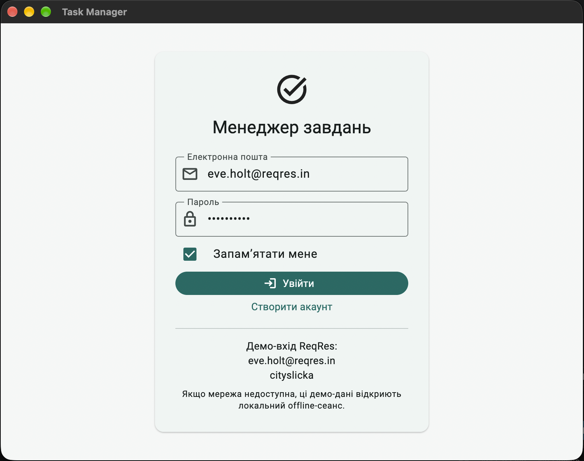

# Практична робота № 11 (частина 3) — менеджер завдань

**Варіант:** 1 — менеджер завдань  
**Дисципліна:** Програмування для мобільних платформ  
**Тема:** REST API, авторизація, кешування та offline-режим

## Опис проєкту

`pr11_3` — Flutter-застосунок для входу користувача й керування списком завдань. Для входу та реєстрації використовується демонстраційний ReqRes API, а список задач завантажується з JSONPlaceholder. Користувач може створювати, редагувати, позначати виконаними й видаляти завдання, шукати їх за назвою та фільтрувати за станом.

Список і локальні зміни кешуються у `shared_preferences`. Якщо пристрій офлайн або API недоступний, застосунок показує збережені завдання. При першому офлайн-запуску створюється короткий локальний приклад, щоб можна було переглянути екран і перевірити основні операції.

## Мета роботи

Опрацювати мережеві запити Dio, interceptors, керування станом через Provider, безпечне збереження токена, перевірку мережевого підключення та кешування API-відповідей для offline-режиму.

## Використані технології

- **Dart і Flutter** — мова та фреймворк застосунку.
- **Material 3** — компоненти інтерфейсу.
- **`dio` 5.11.1** — REST-запити та конфігурація тайм-аутів.
- **`provider` 6.1.5+1** — передавання контролерів стану екранам.
- **`flutter_secure_storage` 11.2.0** — збереження сесії на пристрої.
- **`shared_preferences` 2.5.6** — JSON-кеш завдань і локальних змін.
- **`connectivity_plus` 6.1.5** — відстеження доступного мережевого інтерфейсу.
- **`pretty_dio_logger` 1.4.0** — журналювання запитів у debug-режимі без виведення тіл, заголовків чи токенів.
- **`flutter_test`** — модульні та віджетні тести.
- **Roboto** — шрифт інтерфейсу; ліцензія розміщена поруч у `assets/fonts/Roboto_LICENSE.txt`.

## Функціональні можливості

- Вхід і реєстрація через ReqRes; демонстраційний вхід — `eve.holt@reqres.in` / `cityslicka`.
- Збереження сесії в захищеному сховищі, якщо ввімкнено «Запам’ятати мене», та автоматичне відновлення такої сесії після запуску.
- Демо-вхід з цими самими даними без мережі, якщо запит до ReqRes не отримав відповіді.
- Завантаження завдань JSONPlaceholder з фільтром за `userId`.
- Створення, редагування, видалення та зміна статусу завдань.
- Фільтри «Усі», «Активні», «Виконані», пошук за назвою та лічильники станів.
- Кешування списку й локальних змін; індикатор офлайн-режиму та повторне завантаження.
- Повтор мережевого запиту один раз для помилок з’єднання та помилок сервера; зрозумілі повідомлення про помилки.
- Додавання збереженого access token до запитів завдань як `Bearer`.

## Скріншот

Екран входу, знятий під час запуску macOS-застосунку:



## Структура проєкту

```text
pr11_3/
├── android/, ios/, macos/                 # Платформні конфігурації
├── assets/fonts/                          # Шрифт Roboto та його ліцензія
├── docs/screenshots/login.png             # Скріншот екрана входу
├── lib/
│   ├── core/
│   │   ├── error/app_exception.dart       # Перетворення мережевої помилки
│   │   ├── network/
│   │   │   ├── api_endpoints.dart         # Адреси API та маршрути
│   │   │   ├── dio_client.dart            # Налаштування Dio та logging
│   │   │   └── interceptors/              # Bearer, retry та помилки
│   │   └── storage/                       # Токен, кеш, стан з’єднання
│   ├── features/
│   │   ├── auth/
│   │   │   ├── data/auth_api.dart         # ReqRes запити
│   │   │   ├── domain/auth_session.dart   # Модель сесії
│   │   │   └── presentation/              # Контролер, вхід і AuthGate
│   │   └── tasks/
│   │       ├── data/                      # TaskApi та TaskRepository
│   │       ├── domain/task.dart           # Модель завдання
│   │       └── presentation/              # Список, форма та стан задач
│   ├── shared/widgets/                    # Спільний offline-банер
│   └── main.dart                          # Ініціалізація залежностей
├── test/task_manager_test.dart            # Модель, CRUD, фільтр і кеш
├── analysis_options.yaml                  # Правила Dart analyzer
├── pubspec.yaml                           # Залежності та ресурси
├── pubspec.lock                           # Зафіксовані версії пакетів
└── README.md                              # Документація
```

## Архітектура та реалізація

`main.dart` ініціалізує сховище токенів, `SharedPreferences`, сервіс зв’язку та контролери Provider. `AuthApi` надсилає запити входу й реєстрації до ReqRes. Отриманий токен записується через `flutter_secure_storage`, якщо користувач обрав збереження сесії.

`createTasksDio` налаштовує Dio-клієнт для JSONPlaceholder. `AuthInterceptor` додає `Authorization: Bearer ...`; `RetryInterceptor` повторює транспортні помилки або відповіді 5xx один раз; `ErrorInterceptor` формує повідомлення для UI. У демонстраційному ReqRes API немає окремого маршруту оновлення токена, тому відповідь 401 завершує локальну сесію та повертає користувача на вхід.

`TaskRepository` отримує список `/todos?userId=...` і зберігає його в JSON-кеші. Зміни користувача зберігаються як overrides, а видалені ID — як tombstones. Після мережевого завантаження репозиторій накладає ці локальні зміни на відповідь API. Для локально створених завдань використовуються від’ємні ID, тому вони не конфліктують з ID записів JSONPlaceholder.

`TaskController` керує фільтром, пошуком, лічильниками, станом завантаження та підпискою на зміни з’єднання. `TaskScreen` відображає список, offline-банер, форми редагування й керування завданнями.

### Обмеження демонстраційних API

ReqRes і JSONPlaceholder призначені для навчальних запитів. JSONPlaceholder повертає успішні відповіді на POST, PATCH і DELETE, але не зберігає ці записи на сервері. Тому застосунок зберігає результат цих операцій локально, і він лишається доступним у кеші цього пристрою. ReqRes також надає тестову авторизацію, а не облікові записи для реального сервісу. На macOS увімкнено sandbox-дозвіл на вихідні мережеві запити; Android manifest містить дозволи INTERNET і ACCESS_NETWORK_STATE.

## Встановлення та запуск

Потрібні Flutter SDK, Dart SDK і доступ до мережі для запитів до ReqRes та JSONPlaceholder. Після першого успішного входу збережену сесію й кеш можна відкрити без мережі.

У терміналі з каталогу `pr11_3` виконайте:

```bash
flutter pub get
flutter devices
```

Запуск на macOS:

```bash
flutter run -d macos
```

Запуск на підключеному пристрої або запущеному емуляторі Android (підставте ID зі списку `flutter devices`):

```bash
flutter run -d <device_id>
```

## Перевірки та збірка

```bash
flutter analyze
flutter test
flutter build macos
flutter build apk --debug
```

У `test/task_manager_test.dart` перевіряються JSON-модель завдання, offline-кеш і демо-дані, фільтрація, локальні CRUD-операції та злиття локальних змін з серверним списком.

Результати перевірки цього проєкту:

- `flutter analyze` — проблем не знайдено;
- `flutter test` — усі 3 тести пройшли;
- `flutter build macos` — macOS-застосунок успішно зібрано;
- `flutter build apk --debug` — Android APK успішно зібрано;
- `flutter run -d macos` — застосунок запустився та відкрив екран входу.

## Висновки

Створено менеджер завдань із REST-запитами, авторизацією, Dio interceptors, кешем і offline-переглядом. Під час роботи опрацьовано розділення на data, domain і presentation шари, локальне збереження змін та відновлення сесії.

## Декларація використання ШІ

Під час виконання роботи використовувався ChatGPT для допомоги в написанні та оформленні документації, зокрема текстових описів, README.md, звітів і таблиць.
