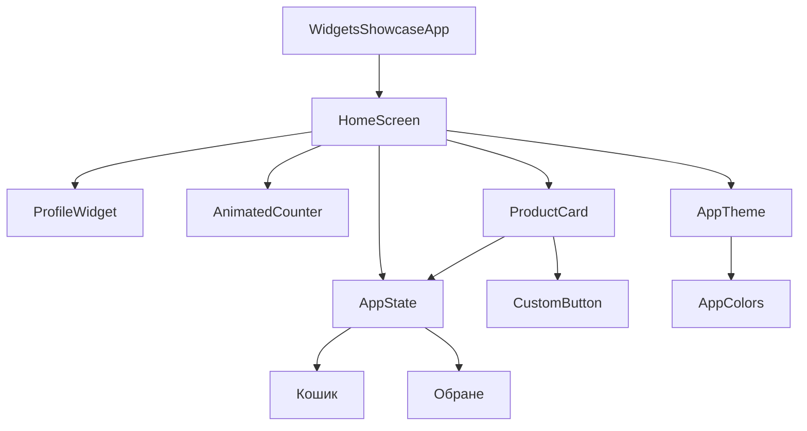
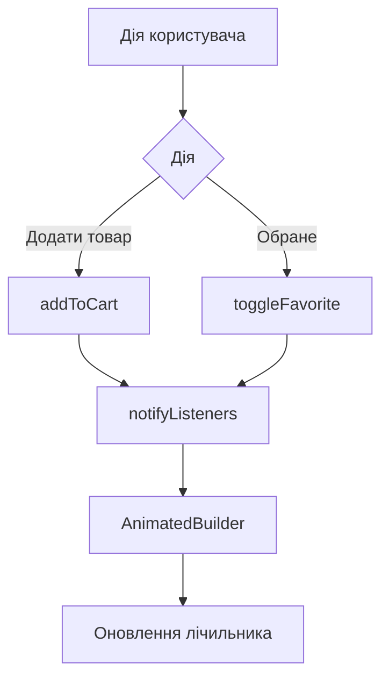

# Архітектура застосунку Widget Store

## 1. Загальна архітектура

Застосунок побудований на Flutter із використанням компонентного підходу. Головний екран `HomeScreen` відображає віджети профілю, лічильника та каталогу товарів. Клас `AppState` на основі `ChangeNotifier` зберігає стан кошика й обраного.

## 2. Керування станом

`AppState` успадковує `ChangeNotifier` і надає методи для додавання товарів до кошика, видалення товарів, очищення кошика та перемикання обраного. Для відображення лічильників у верхній панелі використовується `AnimatedBuilder`.

## 3. Організація коду

- `lib/main.dart` — точка входу та головний екран.
- `lib/models/` — моделі користувача й товару.
- `lib/utils/` — тема, кольори та керування станом.
- `lib/widgets/` — повторно використовувані UI-компоненти.
- `test/` — автоматизовані тести віджетів і стану застосунку.
