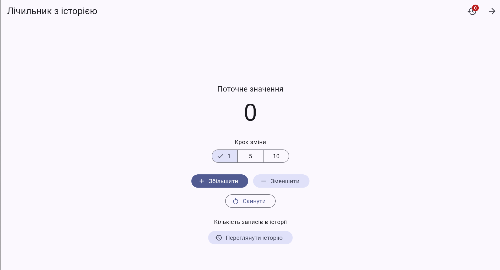
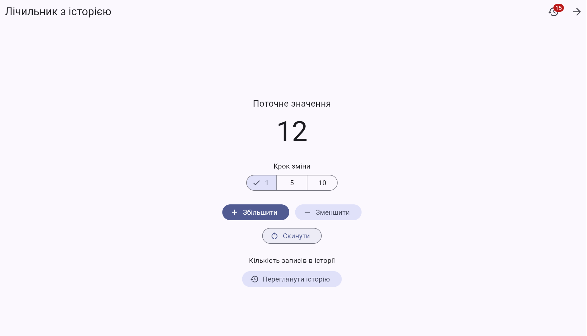
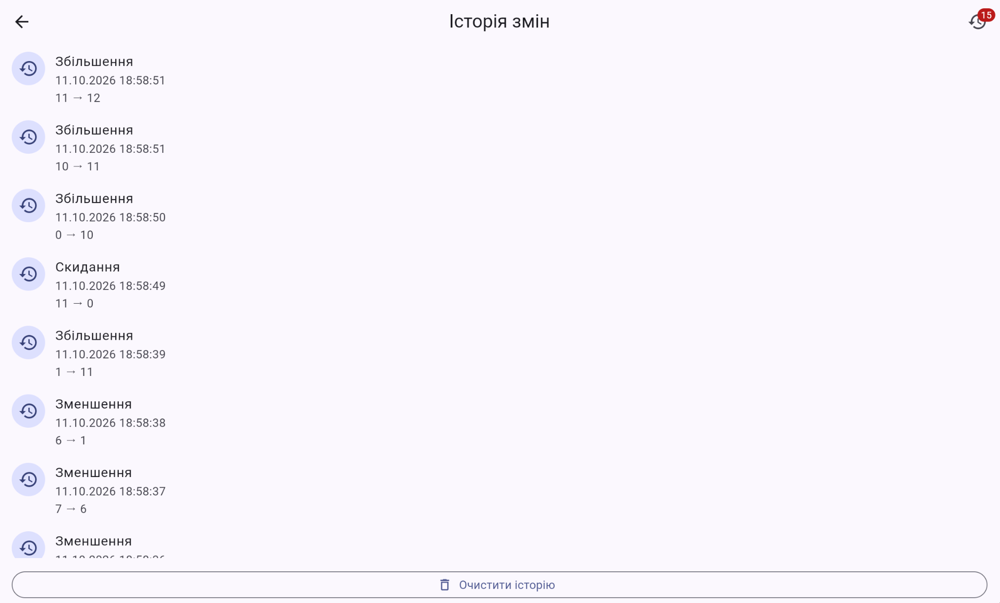

# Практична робота 6.1 — Базовий State Management у Flutter

## Варіант 1. Лічильник з історією

### Мета роботи

Навчитися розрізняти ефемерний стан і стан застосунку, піднімати спільний стан до спільного предка та передавати його через `InheritedNotifier` без використання сторонніх пакетів.

## Функціональність застосунку

- Збільшення та зменшення значення лічильника.
- Вибір кроку зміни: 1, 5 або 10.
- Скидання значення до нуля.
- Заборона від'ємного значення з пояснювальним повідомленням.
- Збереження історії змін із часом, дією та значеннями до і після.
- Окремий екран історії з найновішими записами зверху.
- Очищення історії.
- Бейдж із кількістю записів історії в AppBar.

## Технології

- Flutter SDK і Dart.
- `setState` для ефемерного стану.
- `ChangeNotifier` для спільного стану застосунку.
- `InheritedNotifier` для передавання стану без prop drilling.
- `ListView.builder` для відображення історії.
- Git для фіксації двох етапів реалізації.

Сторонні пакети керування станом не використовуються.

## Структура проєкту

```text
lib/
├── main.dart
├── models/
│   ├── counter_data.dart
│   └── history_entry.dart
├── state/
│   ├── counter_scope.dart
│   └── counter_state.dart
├── screens/
│   ├── counter_screen.dart
│   └── history_screen.dart
└── widgets/
    ├── counter_value.dart
    └── history_badge.dart

test/
└── widget_test.dart
```

## Запуск проєкту

Потрібні встановлені Flutter SDK і Chrome.

```bash
cd pr6
flutter pub get
flutter analyze
flutter test
flutter run -d chrome
```

## Організація стану

| Дані | Де зберігаються | Причина |
|---|---|---|
| Поточне значення лічильника | `CounterState` | Спільний стан, доступний на обох екранах |
| Історія змін | `CounterState` | Потрібна лічильнику та екрану історії |
| Час, дія, значення до та після | Незмінний `HistoryEntry` | Кожна операція зберігається як окремий запис |
| Обраний крок 1 / 5 / 10 | `CounterScreen` через `setState` | Ефемерний стан, потрібний лише екрану лічильника |
| Відкритий екран | Навігація Flutter | Керується через `Navigator` |
| Кількість записів історії | Обчислюється з історії | Не потрібно дублювати дані |

## Етап 1 — `stage-1-lifting`

На першому етапі спільні дані зберігалися в моделі `CounterData`. Стан передавався між екранами через конструктори та callback-функції, а зміни інтерфейсу виконувалися за допомогою `setState`.
Git-тег: `stage-1-lifting`.

## Етап 2 — `stage-2-inherited`

На другому етапі спільний стан винесено до `CounterState`, який наслідує `ChangeNotifier`. Віджет `CounterScope` наслідує `InheritedNotifier` і надає доступ до стану через статичні методи:
- `CounterScope.of(context)` — отримання стану з підпискою на оновлення.
- `CounterScope.read(context)` — отримання стану без підписки на перебудови.
Віджети `CounterValue` та `HistoryBadge` незалежно отримують необхідні дані. Це дозволяє уникнути перебудови всього екрана лічильника при кожній зміні значення.
Git-тег: `stage-2-inherited`.

## Журнал точкових перебудов

Після запуску застосунку початково перебудовуються три віджети:

```text
build: CounterScreen
build: CounterValue
build: HistoryBadge
```

Після натискання кнопки збільшення значення повторно перебудовуються лише віджети, що залежать від спільного стану:

```text
build: CounterValue
build: HistoryBadge
```

`CounterScreen` не перебудовується при зміні значення лічильника. Це підтверджує використання точкових перебудов через `InheritedNotifier`.

## Перевірка

Після реалізації виконано:

```bash
flutter analyze
flutter test
```

Результат статичного аналізу: `No issues found!`.
Результат автоматизованого тестування: `All tests passed!`.

## Скріншоти роботи застосунку

### 1. Початковий екран лічильника



### 2. Лічильник після зміни значення



### 3. Історія змін



## Висновок

У роботі реалізовано застосунок лічильника з історією змін і два підходи до керування станом. Порівняно підняття стану через конструктори й callback-функції з використанням `ChangeNotifier` та `InheritedNotifier`. Реалізовано доступ до спільного стану без передавання даних через проміжні віджети й перевірено точкові перебудови.