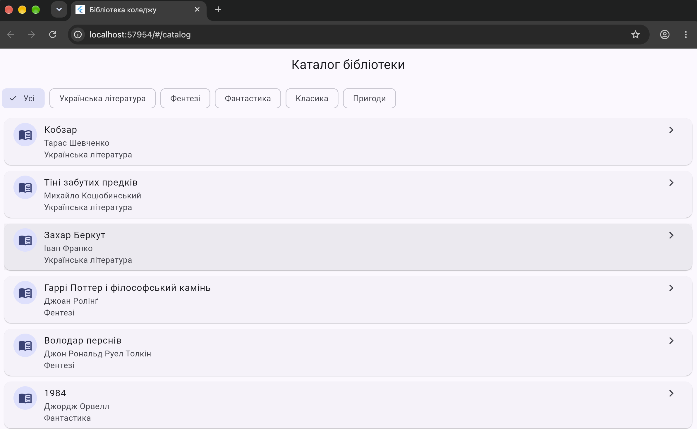
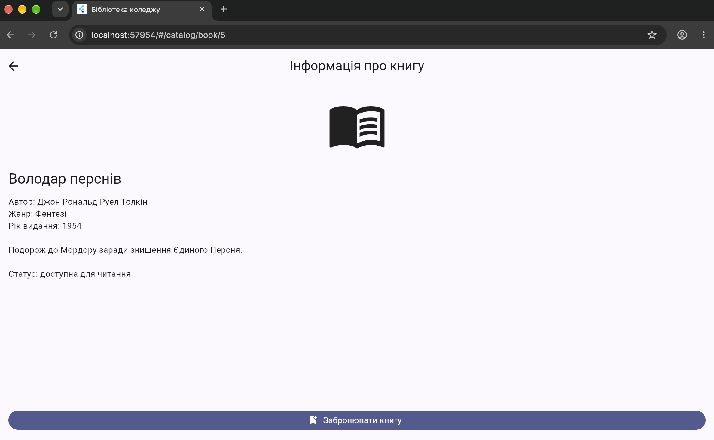
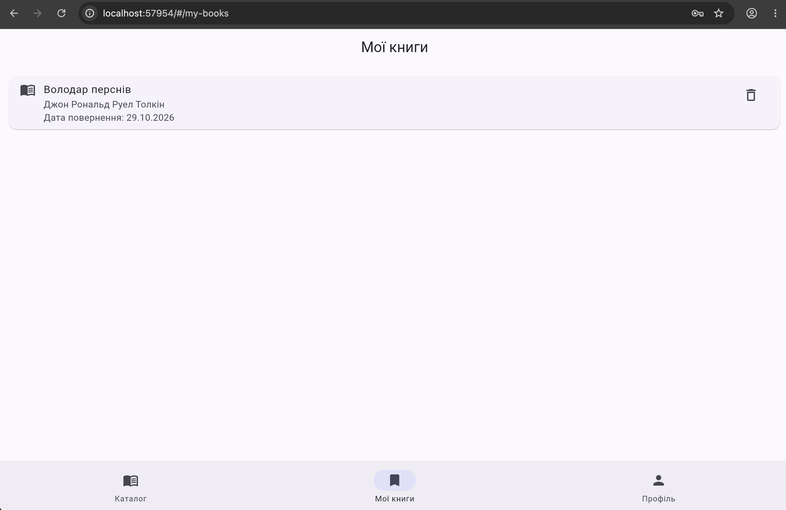
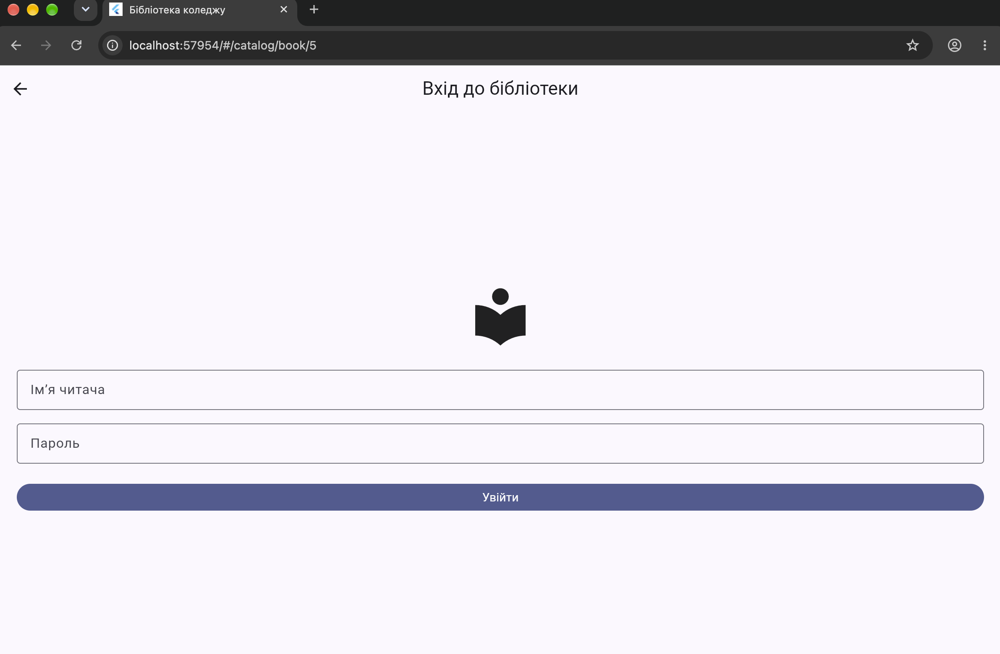
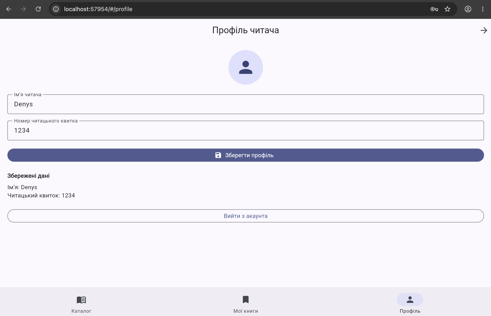
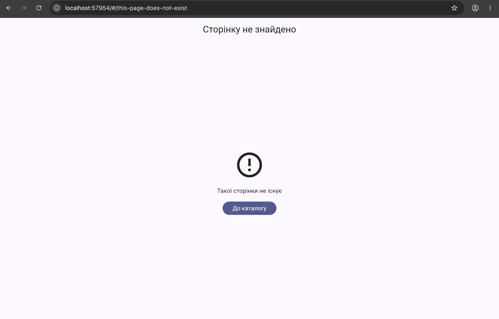

# Практична робота №7 — Роутинг і навігація у Flutter

## Тема

Реалізація маршрутизації та навігації в мобільному застосунку з використанням бібліотеки `go_router`.

## Мета роботи

Навчитися створювати маршрути, передавати параметри, реалізовувати захист маршрутів, повертати результати між екранами та налаштовувати Deep Links у Flutter.

## Опис проєкту

Розроблено застосунок «Бібліотека коледжу», який дає змогу переглядати каталог книг, відкривати інформацію про книгу, авторизуватися, бронювати книги й керувати профілем читача.
Дані застосунку зберігаються в оперативній пам’яті. Підключення до сервера або бази даних не використовується.

## Використані технології

- Flutter та Dart.
- `go_router` для маршрутизації.
- `ChangeNotifier` для сповіщення про зміну стану.
- `StatefulShellRoute.indexedStack` для нижньої навігації.
- `PopScope` для контролю виходу з форми.
- Android Intent Filters та iOS URL Types для Deep Links.

## Карта маршрутів

| Маршрут | Призначення |
|---|---|
| `/catalog` | Каталог книг |
| `/catalog?genre=Фентезі` | Каталог із фільтром за жанром |
| `/catalog/book/:bookId` | Деталі книги |
| `/catalog/book/:bookId/reserve` | Бронювання книги |
| `/my-books` | Заброньовані книги |
| `/profile` | Профіль читача |
| `/login?from=...` | Авторизація з поверненням до запитаного маршруту |
| `/select-date` | Вибір дати повернення |
| Невідомий маршрут | Екран помилки |

## Реалізовані можливості

1. Нижня навігація між каталогом, заброньованими книгами та профілем.
2. Збереження стану вкладок через `StatefulShellRoute.indexedStack`.
3. Передавання параметра книги через `:bookId`.
4. Фільтрація каталогу через query-параметр `genre`.
5. Захист маршруту бронювання для неавторизованих користувачів.
6. Повернення до запитаного маршруту після входу.
7. Повернення вибраної дати через `context.push<DateTime>()` і `context.pop(selected)`.
8. Підтвердження виходу з незбереженої форми через `PopScope`.
9. Обробка невідомих маршрутів через `errorBuilder`.
10. Реєстрація схеми `library` для Deep Links на Android та iOS.

## 📸 Скріншоти роботи застосунку

Нижче наведено основні екрани застосунку «Бібліотека коледжу» та результати перевірки навігації.

### 1. Каталог книг



Головний екран застосунку з переліком доступних книг. Користувач може переглядати каталог, фільтрувати книги за жанрами та переходити до детальної інформації про вибране видання.

### 2. Детальна інформація про книгу



Екран із детальною інформацією про вибрану книгу. Звідси користувач може перейти до оформлення бронювання.

### 3. Бронювання книги


Екран оформлення бронювання книги з можливістю вибрати дату отримання. Вибрана дата повертається на попередній екран і використовується під час створення бронювання.

### 4. Мої книги



Екран зі списком заброньованих книг. Користувач може переглядати свої бронювання та скасовувати їх.

### 5. Авторизація



Екран входу, який демонструє захист маршруту. Якщо користувач відкриває сторінку бронювання без авторизації, застосунок перенаправляє його на екран входу, а після успішної авторизації повертає до запитаного маршруту.

### 6. Профіль користувача



Екран профілю з можливістю редагування даних користувача та збереження змін.

### 7. Підтвердження виходу без збереження


Діалогове вікно, яке попереджає про незбережені зміни у формі профілю. Користувач може підтвердити вихід або залишитися на екрані.

### 8. Обробка невідомого маршруту



Екран помилки для невідомого URL. Він демонструє використання `errorBuilder` у `GoRouter` для обробки маршрутів, які не визначені в конфігурації застосунку.

## Перевірка

Перевірка статичного аналізу:

```bash
flutter analyze
```

Запуск тестів:

```bash
flutter test
```

Запуск у Chrome:

```bash
flutter run -d chrome
```

## Перевірка Deep Links

Для Android після встановлення застосунку на емулятор або пристрій:

```bash
adb shell am start -a android.intent.action.VIEW -d "library://app/catalog/book/1"
```

Очікується відкриття деталей книги з ідентифікатором `1`.
Для iOS можна перевірити схему на симуляторі після його налаштування:

```bash
xcrun simctl openurl booted "library://app/catalog/book/1"
```

Реальне відкриття Deep Links на Android та iOS потрібно підтвердити окремим запуском на відповідній платформі.

## Висновок

У результаті практичної роботи створено Flutter-застосунок бібліотеки з маршрутизацією через `go_router`. Реалізовано вкладену навігацію, параметри маршрутів, захист бронювання, повернення результатів між екранами, контроль незбережених змін і конфігурацію Deep Links для Android та iOS.