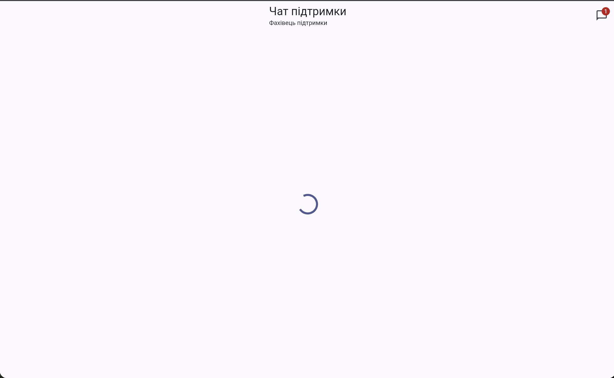
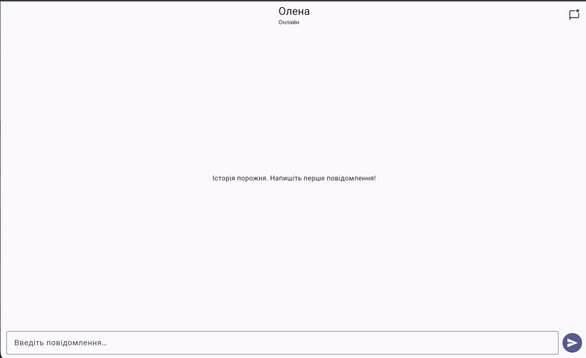
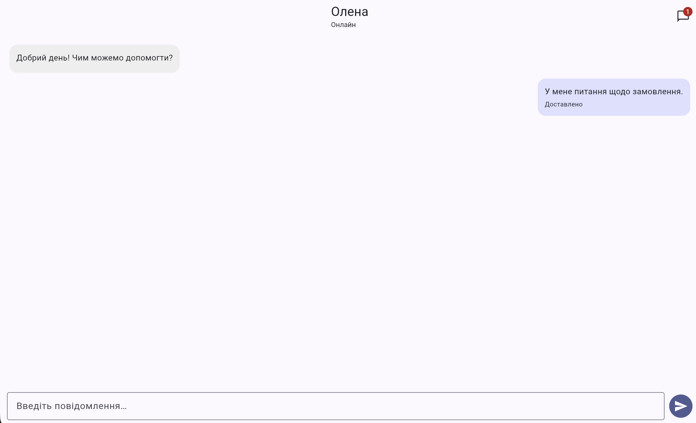
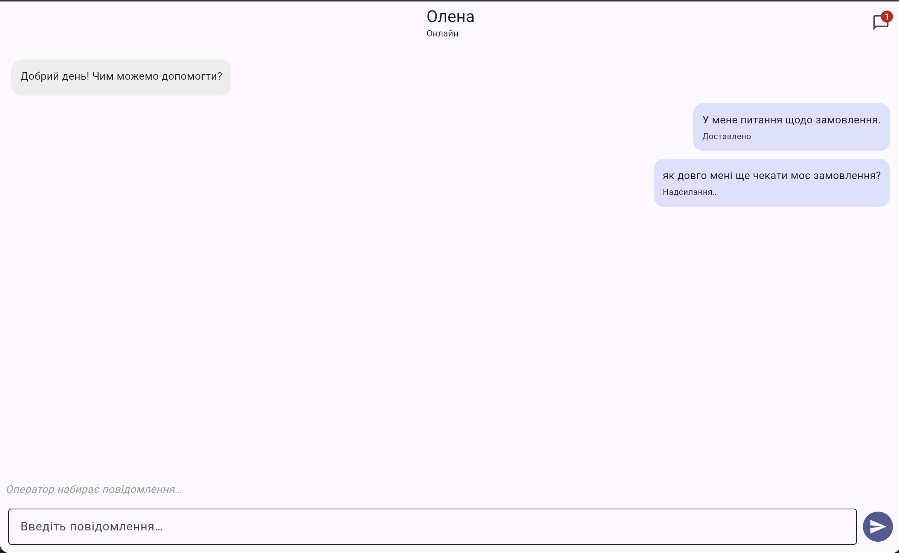

# Практична робота №8 — Робота з асинхронним кодом у Dart

## Варіант 2. Чат служби підтримки

### 1. Опис проєкту

Мобільний застосунок на Flutter, який імітує чат із оператором служби підтримки. Застосунок демонструє асинхронне завантаження даних, роботу з `Future` і `Stream`, обробку помилок та оновлення інтерфейсу в реальному часі.

Основні можливості:
- паралельне завантаження історії повідомлень і профілю оператора;
- відображення повідомлень користувача й оператора;
- імітація відповіді оператора із затримкою 2–5 секунд;
- індикатор набору відповіді;
- статуси повідомлень: «Надсилання», «Доставлено», «Не доставлено»;
- повторне надсилання повідомлень після помилки;
- лічильник повідомлень оператора в AppBar;
- відображення станів завантаження, помилки та порожньої історії.

### 2. Технології

- Flutter і Dart;
- `Future`, `async` і `await`;
- `Future.wait` для паралельних запитів;
- `FutureBuilder` для початкового завантаження;
- `StreamController.broadcast()` для подій повідомлень;
- `StreamBuilder` для оновлення списку повідомлень;
- `Future.delayed` для імітації мережевої затримки;
- `timeout` для обмеження часу очікування;
- `mounted` для перевірки стану віджета після асинхронних операцій.

### 3. Структура проєкту

```text
pr8/
├── lib/
│   ├── main.dart
│   ├── models/
│   │   ├── message.dart
│   │   └── operator.dart
│   ├── screens/
│   │   └── chat_screen.dart
│   └── services/
│       ├── chat_controller.dart
│       └── chat_service.dart
├── test/
│   └── widget_test.dart
├── docs/
└── README.md
```

### 4. Запуск застосунку

Необхідно встановити Flutter SDK та Google Chrome.

Відкрийте термінал у папці проєкту й виконайте:

```bash
flutter pub get
flutter analyze
flutter test
flutter run -d chrome
```

### 5. Асинхронне завантаження

У файлі `lib/screens/chat_screen.dart`, метод `_loadInitialData()`, використовується `Future.wait`, щоб одночасно завантажити історію повідомлень і профіль оператора.

```dart
final results = await Future.wait<Object>([
  _service.loadMessages(),
  _service.loadOperator(),
]).timeout(const Duration(seconds: 5));
```

`FutureBuilder` відображає індикатор завантаження та дозволяє показувати результат після завершення початкового запиту. Майбутній об'єкт для `FutureBuilder` створюється в `initState()`, а не в `build()`.

### 6. Імітація мережі та помилки

У файлі `lib/services/chat_service.dart` клас `ChatService` імітує мережеві запити за допомогою `Future.delayed`.

Параметр `failureRate` задає ймовірність випадкового збою. Для демонстрації помилок можна змінити його значення під час розробки.

Початкове завантаження має тайм-аут. Надсилання повідомлення також обмежене часом очікування. Якщо запит завершується помилкою, повідомлення отримує статус «Не доставлено», після чого його можна надіслати повторно.

### 7. Потоки та оновлення інтерфейсу

У файлі `lib/services/chat_controller.dart` використовується `StreamController<ChatMessage>.broadcast()` для розсилання подій повідомлень.

На цей потік підписані два слухачі в `lib/screens/chat_screen.dart`:
1. перший оновлює список повідомлень;
2. другий оновлює лічильник повідомлень оператора.

Окремий потік `messagesListStream` передає актуальний список повідомлень у `StreamBuilder`, який перебудовує відповідну частину інтерфейсу.

#### Чому використовується broadcast?

Звичайний `StreamController` за замовчуванням створює single-subscription stream, який не призначений для кількох незалежних підписок. У цьому проєкті потрібні два слухачі одного потоку, тому використовується `StreamController.broadcast()`.

### 8. Очищення ресурсів

У методі `dispose()` віджета `ChatScreen` скасовуються підписки та звільняються контролери текстового поля і прокручування.

Метод `dispose()` класу `ChatController` закриває потоки повідомлень, списку повідомлень і стану набору тексту.

Після асинхронних операцій у віджеті перевіряється `mounted`, щоб не викликати `setState()` після видалення віджета з дерева.

### 9. Перевірка

Для статичного аналізу виконується:

```bash
flutter analyze
```

Для запуску тестів:

```bash
flutter test
```

### 10. Скріншоти

### 1. Завантаження даних



### 2. Обробка помилки завантаження


### 3. Порожня історія чату



### 4. Завантажений чат



### 5. Обмін повідомленнями в реальному часі



### 11. Висновок

Під час виконання практичної роботи створено чат служби підтримки з імітацією асинхронних мережевих запитів. Реалізовано паралельне завантаження даних, потоки повідомлень, відображення станів запитів, обробку помилок і повторне надсилання. Робота демонструє застосування `Future`, `Stream`, `FutureBuilder`, `StreamBuilder` і керування життєвим циклом асинхронних ресурсів.