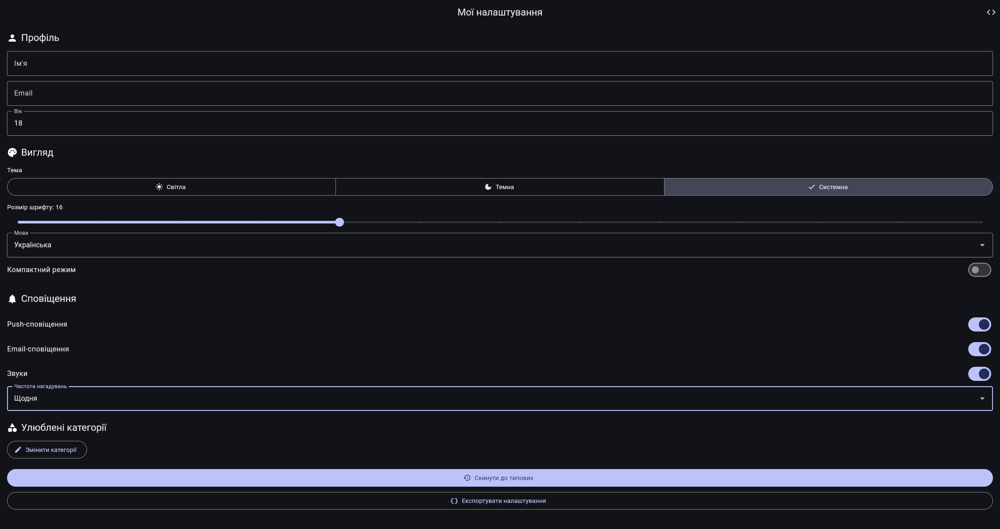
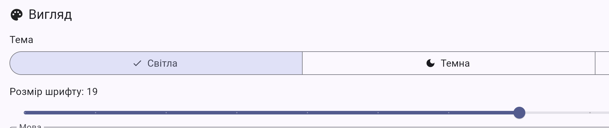
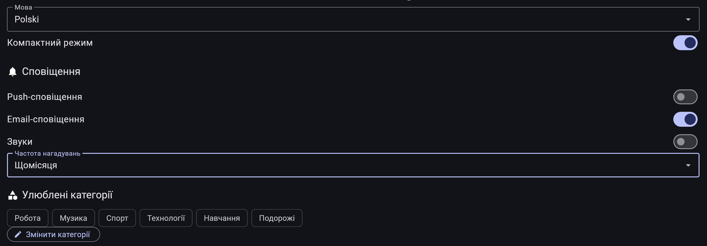
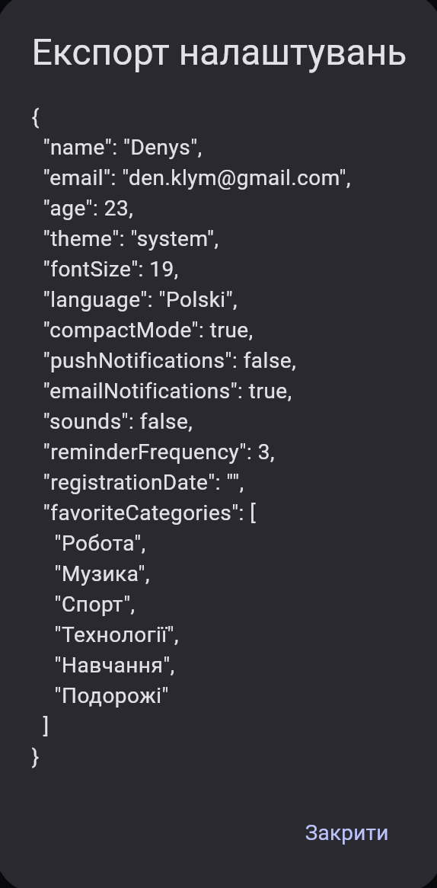
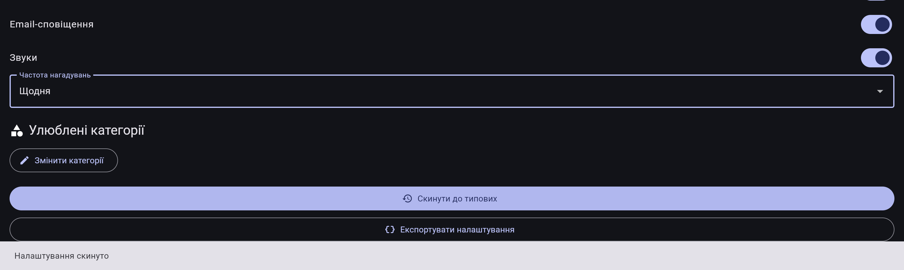

# Менеджер налаштувань користувача

## Загальна інформація

- **Назва застосунку:** Менеджер налаштувань користувача (Settings Manager).
- **Практична робота:** № 9.1.
- **Варіант:** 1.
- **Механізм збереження даних:** SharedPreferences.

## Опис застосунку

Мобільний застосунок «Менеджер налаштувань користувача» призначений для налаштування персональних параметрів інтерфейсу та збереження користувацьких уподобань. Він надає можливість редагувати ім'я й електронну пошту, змінювати тему оформлення, налаштовувати розмір шрифту, вибирати мову інтерфейсу, вмикати компактний режим і керувати параметрами сповіщень.

Для збереження налаштувань використовується пакет SharedPreferences, який дає змогу зберігати прості типи даних локально на пристрої. Реалізовано централізоване керування налаштуваннями, отримання їхніх значень, скидання до стандартних параметрів і експорт даних у форматі JSON. Інтерфейс дає змогу змінювати параметри безпосередньо в застосунку.

## Реалізовані функції

- [x] Збереження налаштувань користувача за допомогою SharedPreferences.
- [x] Централізоване керування налаштуваннями через клас `PreferencesManager`.
- [x] Використання шаблону Singleton для менеджера налаштувань.
- [x] Встановлення стандартних значень налаштувань.
- [x] Редагування імені користувача.
- [x] Редагування електронної пошти.
- [x] Перемикання між світлою та темною темами.
- [x] Налаштування розміру шрифту.
- [x] Вибір мови інтерфейсу.
- [x] Увімкнення та вимкнення компактного режиму.
- [x] Керування параметрами сповіщень.
- [x] Налаштування частоти нагадувань.
- [x] Вибір улюблених категорій.
- [x] Отримання окремого значення налаштування.
- [x] Отримання всіх збережених налаштувань.
- [x] Видалення окремого налаштування.
- [x] Очищення збережених налаштувань.
- [x] Скидання налаштувань до стандартних значень.
- [x] Експорт налаштувань у форматі JSON.
- [x] Автоматичне збереження змін під час роботи з налаштуваннями.
- [x] Обробка помилок збереження.
- [x] Модульний тест для перевірки відображення головного екрана.

## Скріншоти

У цьому розділі наведено місця для скріншотів, які демонструють роботу застосунку.

### 1. Головний екран налаштувань



### 2. Налаштування профілю


### 3. Налаштування теми та шрифту


s
### 4. Додаткові параметри



### 5. Скидання та експорт





## Технічні деталі

### Технології та інструменти

| Технологія | Призначення |
|---|---|
| Flutter | Розроблення користувацького інтерфейсу та мобільного застосунку |
| Dart | Основна мова програмування |
| SharedPreferences | Локальне збереження простих типів даних |
| flutter_test | Написання та запуск тестів |
| Material Design | Побудова інтерфейсу на основі віджетів Flutter |

### Використані пакети

| Пакет | Призначення |
|---|---|
| `shared_preferences` | Збереження та отримання налаштувань користувача |
| `flutter_test` | Тестування віджетів застосунку |

Пакет `shared_preferences` використовується для роботи з локальним сховищем. Пакет `flutter_test` застосовується для перевірки роботи інтерфейсу та виконання автоматизованих тестів.

### Архітектура проєкту

Основна логіка застосунку розділена на три компоненти:

- **`main.dart`** — точка входу в застосунок. Ініціалізує застосунок, керує головним віджетом і передає зміни режиму теми.
- **`services/preferences_manager.dart`** — сервісний клас `PreferencesManager`, який відповідає за централізовану роботу з налаштуваннями, їх збереження, отримання, видалення, скидання та експорт.
- **`screens/settings_screen.dart`** — екран налаштувань, що містить елементи керування для редагування профілю та зміни параметрів застосунку.

Для класу `PreferencesManager` використовується шаблон Singleton, завдяки якому доступ до менеджера здійснюється через спільний екземпляр. Це дає змогу централізувати операції з локальним сховищем.

### Структура проєкту

```text
pr9/
├── lib/
│   ├── main.dart
│   ├── screens/
│   │   └── settings_screen.dart
│   └── services/
│       └── preferences_manager.dart
├── test/
│   └── widget_test.dart
├── screenshots/
│   ├── main_screen.png
│   ├── profile_settings.png
│   ├── theme_font_settings.png
│   ├── additional_settings.png
│   └── reset_export.png
├── pubspec.yaml
└── README.md
```

## Тестування

Для перевірки застосунку використовувалися стандартні інструменти Flutter.

Основні команди перевірки:

```bash
flutter analyze
flutter test
flutter run
```

- `flutter analyze` — аналіз коду на наявність помилок і зауважень.
- `flutter test` — запуск автоматизованих тестів.
- `flutter run` — запуск застосунку для перевірки його роботи.

У модульному тесті використовується `SharedPreferences.setMockInitialValues({})`, щоб ініціалізувати тестове локальне сховище. Тест перевіряє, чи відображається головний екран із заголовком «Мої налаштування».

## Труднощі та рішення

### 1. Робота із SharedPreferences під час тестування

**Труднощі:** під час запуску віджетного тесту виникала проблема з доступом до локального сховища SharedPreferences, оскільки тестове середовище не використовує звичайне сховище пристрою.

**Рішення:** перед виконанням тестів було додано ініціалізацію тестових значень за допомогою `SharedPreferences.setMockInitialValues({})`. Це дало змогу перевіряти інтерфейс без необхідності використовувати реальне локальне сховище.

### 2. Очікування завершення асинхронних операцій у тестах

**Труднощі:** використання `pumpAndSettle()` спричиняло проблеми під час очікування завершення всіх анімацій і асинхронних операцій.

**Рішення:** тест було адаптовано, щоб явно ініціалізувати тестове сховище та використовувати `pump()` з визначеним інтервалом замість очікування повного завершення всіх процесів.

### 3. Надмірні повідомлення про успішне збереження

**Труднощі:** повідомлення про успішне збереження з'являлися після кожної зміни значення, зокрема під час введення кожного символу в поля профілю.

**Рішення:** повідомлення про успішне збереження було прибрано з методу `_save()`. Обробку помилок збереження залишено, щоб користувач міг отримати повідомлення в разі виникнення проблем.

### 4. Зауваження статичного аналізатора

**Труднощі:** після зміни логіки збереження статичний аналізатор повідомив про невикористовуване поле `_saving`.

**Рішення:** передбачено видалення поля `_saving` та пов'язаного з ним індикатора завантаження з `AppBar`, оскільки вони більше не використовувалися.

## Висновок

У межах практичної роботи № 9.1 розроблено Flutter-застосунок для керування персональними налаштуваннями користувача. Реалізовано локальне збереження параметрів за допомогою SharedPreferences, централізований сервіс керування налаштуваннями, зміну параметрів інтерфейсу, скидання налаштувань та експорт даних у JSON.

Також було налаштовано тестування ізольованого середовища SharedPreferences, перевірено відображення головного екрана та вдосконалено зворотний зв'язок для користувача під час збереження налаштувань.