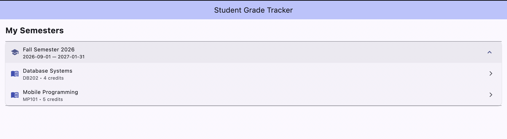
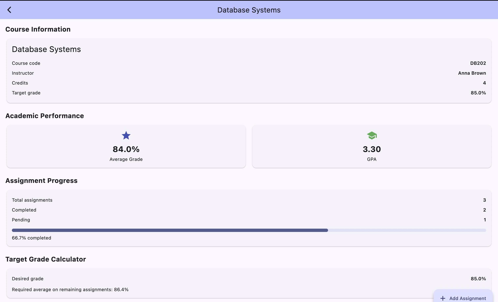
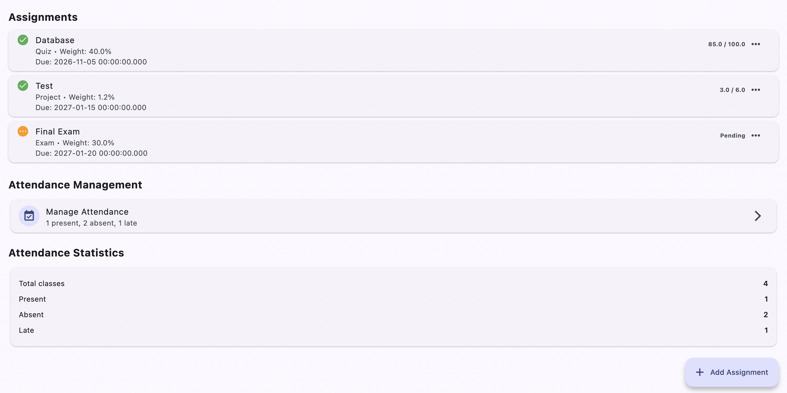
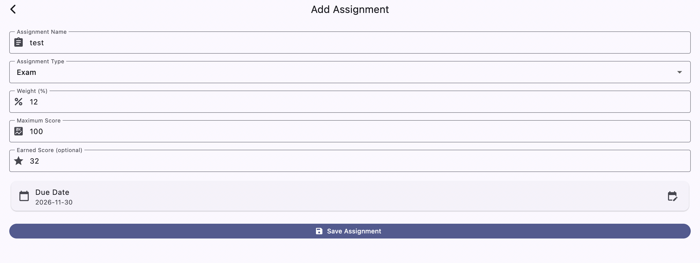
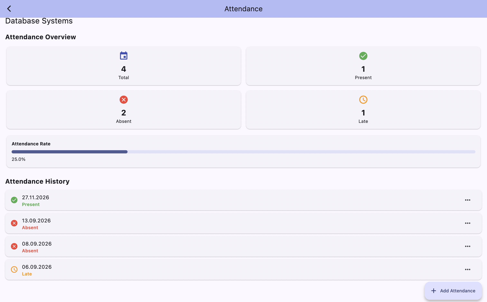
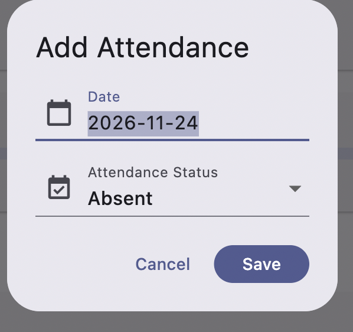

# Практична робота №9.2
# Робота з SQLite та Hive у Flutter

## 1. Мета роботи

Метою практичної роботи є ознайомлення з принципами локального зберігання даних у мобільних застосунках Flutter, вивчення особливостей використання бази даних SQLite, а також отримання практичних навичок реалізації операцій створення, читання, оновлення та видалення записів (CRUD).

У межах роботи було розроблено застосунок **Student Grade Tracker**, призначений для обліку навчальних курсів, завдань, оцінок та відвідуваності студентів.

## 2. Обраний варіант завдання

Для виконання практичної роботи було обрано варіант №5 — **Student Grade Tracker**.

Розроблений застосунок дозволяє зберігати інформацію про навчальні семестри, курси, завдання та відвідуваність. Основне призначення програми — надати можливість студенту відстежувати власну успішність, переглядати статистику виконання завдань і контролювати відвідування занять.

Основні можливості застосунку:
- перегляд навчальних семестрів і курсів;
- зберігання інформації про навчальні дисципліни;
- додавання, редагування та видалення навчальних завдань;
- збереження отриманих балів і ваги кожного завдання;
- автоматичний розрахунок середнього бала;
- обчислення GPA за шкалою 4.0;
- визначення необхідного бала для досягнення цільової оцінки;
- облік відвідуваності занять;
- перегляд статистики присутності, відсутності та запізнень.

## 3. Використані технології

Під час розробки застосунку було використано такі технології та інструменти:

| Технологія | Призначення |
|---|---|
| Flutter | Розробка користувацького інтерфейсу |
| Dart | Основна мова програмування |
| SQLite | Локальне реляційне зберігання даних |
| sqflite | Взаємодія з базою даних SQLite |
| path | Формування шляхів до файлу бази даних |
| sqflite_common_ffi | Забезпечення роботи SQLite через FFI на macOS |
| Visual Studio Code | Розробка та налагодження застосунку |

Для запуску застосунку на macOS було налаштовано SQLite FFI.

## 4. Структура проєкту

Проєкт має модульну структуру, у якій окремі компоненти відповідають за роботу з базою даних, моделі, екрани інтерфейсу, обчислення та початкове наповнення даних.

Основна структура каталогу `lib`:

```text
lib/
├── main.dart
├── database/
│   └── database_helper.dart
├── models/
│   ├── semester.dart
│   ├── course.dart
│   ├── assignment.dart
│   └── attendance.dart
├── screens/
│   ├── course_details_screen.dart
│   ├── assignment_form_screen.dart
│   └── attendance_screen.dart
├── utils/
│   ├── grade_calculator.dart
│   └── database_seeder.dart
└── widgets/
```

Призначення основних компонентів:

- **main.dart** — точка входу в застосунок, ініціалізація Flutter, SQLite FFI та початкових даних.
- **database_helper.dart** — створення бази даних, налаштування таблиць, зв'язків і реалізація CRUD-операцій.
- **models/** — моделі даних для семестрів, курсів, завдань і відвідуваності.
- **course_details_screen.dart** — відображення інформації про курс, оцінок, статистики та завдань.
- **assignment_form_screen.dart** — форма створення та редагування навчальних завдань.
- **attendance_screen.dart** — керування відвідуваністю та перегляд відповідної статистики.
- **grade_calculator.dart** — функції розрахунку середнього бала, GPA та необхідного результату.
- **database_seeder.dart** — початкове наповнення бази даних демонстраційними записами.

## 5. Проєктування бази даних

Для зберігання інформації було створено локальну базу даних SQLite. Вона містить чотири основні таблиці:

1. `semesters` — інформація про навчальні семестри.
2. `courses` — навчальні дисципліни.
3. `assignments` — завдання та результати їх виконання.
4. `attendance` — записи про відвідування занять.

### 5.1. Структура таблиць

**Таблиця semesters** зберігає інформацію про навчальні семестри.

**Таблиця courses** містить навчальні дисципліни, пов'язані з відповідними семестрами. Для кожного курсу зберігаються назва, кількість кредитів та цільова оцінка.

**Таблиця assignments** використовується для зберігання навчальних завдань. Кожен запис містить назву завдання, його вагу, максимальний бал, отриманий бал та дату виконання або запланованого завершення.

**Таблиця attendance** призначена для обліку відвідуваності. У ній зберігається дата заняття, статус присутності та додаткова примітка.

### 5.2. Зв'язки між таблицями

Для забезпечення цілісності даних використовуються зовнішні ключі:

- один семестр може містити декілька курсів;
- один курс може містити декілька навчальних завдань;
- один курс може мати декілька записів про відвідуваність.

Для зовнішніх ключів налаштовано каскадне видалення (`ON DELETE CASCADE`). Також увімкнено підтримку зовнішніх ключів SQLite та створено індекси для оптимізації окремих запитів.

## 6. Реалізація роботи з базою даних

Для централізованої взаємодії з SQLite було створено клас `DatabaseHelper`. Він реалізований за принципом Singleton, що дозволяє використовувати єдиний екземпляр помічника бази даних у різних частинах застосунку.

У класі реалізовано:
- ініціалізацію та відкриття бази даних;
- створення таблиць;
- налаштування зовнішніх ключів;
- додавання нових записів;
- отримання інформації з таблиць;
- оновлення наявних записів;
- видалення записів;
- виконання додаткових SQL-запитів для отримання статистики.

### 6.1. CRUD-операції

У застосунку реалізовано повний набір CRUD-операцій:

| Операція | Призначення |
|---|---|
| Create | Додавання нових записів до бази даних |
| Read | Отримання та відображення збережених даних |
| Update | Редагування інформації про завдання та відвідуваність |
| Delete | Видалення записів |

Операції CRUD використовуються для роботи з навчальними завданнями та відвідуваністю. Усі зміни зберігаються безпосередньо в SQLite.

## 7. Інтерфейс та основний функціонал застосунку

### 7.1. Головний екран

На головному екрані відображаються навчальні семестри та курси, доступні користувачу. Для кожного курсу можна перейти до детальної інформації про успішність, завдання та відвідуваність.



*Рисунок 1 — Головний екран Student Grade Tracker.*

### 7.2. Детальна інформація про курс

Після вибору курсу відкривається сторінка з основною інформацією про навчальну дисципліну. На ній відображаються середній бал, GPA, прогрес виконання завдань, а також інформація про цільову оцінку.



*Рисунок 2 — Сторінка з детальною інформацією про курс.*

### 7.3. Список навчальних завдань

Для кожного курсу передбачено список навчальних завдань. Користувач може переглядати назви завдань, їхні вагові коефіцієнти, отримані бали та іншу пов'язану інформацію.



*Рисунок 3 — Список завдань для вибраного курсу.*

### 7.4. Створення та редагування завдань

Для додавання нового завдання або редагування наявного використовується окрема форма. Вона дозволяє вказати назву завдання, його вагу, максимальний та отриманий бал, а також дату виконання.



*Рисунок 4 — Форма створення та редагування навчального завдання.*

### 7.5. Керування відвідуваністю

Окремий екран призначений для перегляду та керування відвідуваністю занять. На ньому відображаються статистичні показники та історія відвідування.

Для кожного заняття можна встановити один із трьох статусів:
- `Present` — присутній;
- `Absent` — відсутній;
- `Late` — запізнився.



*Рисунок 5 — Екран керування відвідуваністю та статистика.*

### 7.6. Додавання та редагування записів відвідуваності

Для внесення інформації про відвідування передбачено окрему форму. Користувач може вибрати дату заняття, встановити відповідний статус та додати примітку.



*Рисунок 6 — Форма додавання та редагування запису відвідуваності.*

## 8. Реалізація розрахунку успішності

Для виконання математичних розрахунків було створено окремий клас `GradeCalculator`.

Він містить декілька основних функцій.

### 8.1. Розрахунок середнього бала

Середній бал обчислюється з урахуванням ваги кожного навчального завдання. Це дозволяє враховувати різну важливість завдань у загальній оцінці.

### 8.2. Розрахунок GPA

Для перетворення відсоткового результату в GPA використовується шкала від 0.0 до 4.0.

### 8.3. Розрахунок необхідного бала

У застосунку передбачено можливість визначення результату, який потрібно отримати за наступні завдання, щоб досягти встановленої цільової оцінки.

### 8.4. Статистика виконання завдань

Додатково реалізовано підрахунок загальної кількості завдань та кількості завершених завдань. На основі цих даних визначається відсоток виконання.

## 9. Початкове наповнення бази даних

Для демонстрації роботи застосунку реалізовано клас `DatabaseSeeder`, який автоматично додає початкові демонстраційні дані, якщо база даних ще не містить семестрів.

Під час першого запуску створюється навчальний семестр **Fall Semester 2026**, до якого додаються два курси:
- Mobile Programming;
- Database Systems.

Для кожного курсу також створюються демонстраційні навчальні завдання та записи про відвідуваність.

Повторне наповнення не виконується, якщо в базі вже є семестри. Це дозволяє уникнути дублювання початкових записів.

## 10. Тестування застосунку

Після реалізації основного функціоналу було проведено перевірку роботи застосунку.

Під час тестування перевірялися такі можливості:

| № | Перевірка | Результат |
|---|---|---|
| 1 | Запуск застосунку та ініціалізація бази даних | Успішно |
| 2 | Відображення семестрів і навчальних курсів | Успішно |
| 3 | Перегляд інформації про курс | Успішно |
| 4 | Додавання нового навчального завдання | Успішно |
| 5 | Редагування навчального завдання | Успішно |
| 6 | Видалення навчального завдання | Успішно |
| 7 | Збереження даних після перезапуску застосунку | Успішно |
| 8 | Розрахунок середнього бала та GPA | Успішно |
| 9 | Розрахунок необхідного бала для цільової оцінки | Успішно |
| 10 | Додавання записів про відвідуваність | Успішно |
| 11 | Редагування записів про відвідуваність | Успішно |
| 12 | Видалення записів про відвідуваність | Успішно |
| 13 | Оновлення статистики відвідуваності | Успішно |

За результатами перевірки встановлено, що основні функції застосунку працюють коректно. Дані зберігаються в локальній базі SQLite та залишаються доступними після повного перезапуску програми.

## 11. Висновки

Під час виконання практичної роботи було розроблено мобільний застосунок Student Grade Tracker із використанням Flutter, Dart та SQLite.

У процесі розробки було реалізовано локальне зберігання даних, створено чотири взаємопов'язані таблиці, налаштовано зовнішні ключі та реалізовано CRUD-операції. Також було розроблено функціонал для обліку навчальних завдань, розрахунку успішності та контролю відвідуваності.

Окрему увагу приділено структурі проєкту, розділенню логіки роботи з базою даних, моделей і користувацького інтерфейсу.

Проведене тестування підтвердило коректність роботи реалізованих функцій і збереження інформації після перезапуску застосунку.

У результаті було отримано практичний досвід роботи з SQLite у Flutter, реалізації локального зберігання даних, виконання SQL-запитів та побудови застосунку з використанням реляційної бази даних.